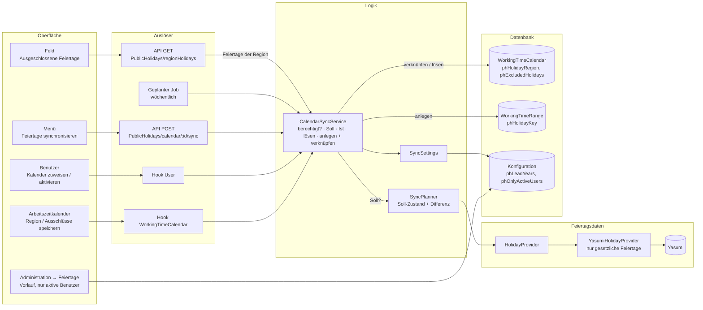

# Public Holidays für EspoCRM

[English](README.md) | **Deutsch**

Erweiterung für EspoCRM ab 10.0. Sie legt gesetzliche Feiertage automatisch als **arbeitsfreie Ausnahmen** in den Arbeitszeitkalendern an. Die Feiertage berechnet die Bibliothek [Yasumi](https://www.yasumi.dev) für 156 Länder und Regionen, darunter alle deutschen Bundesländer, Österreich und die Schweiz.

## Funktionen

- **Feiertagsregion pro Arbeitszeitkalender:** neues Panel „Feiertage“ am Kalender, zum Beispiel *Deutschland – Baden-Württemberg*. Bleibt das Feld leer, ist die Funktion für diesen Kalender aus.
- **Ausgeschlossene Feiertage:** Pro Kalender lassen sich einzelne Feiertage der Region abwählen.
- **Nur gesetzliche Feiertage:** Es werden nur Tage vom Yasumi-Typ „official“ angelegt. Heiligabend, Silvester oder regional eingeschränkte Tage (z. B. Mariä Himmelfahrt in Bayern) gehören nicht dazu.
- **Eine Ausnahme pro Feiertag und Region:** Sie wird mit allen passenden Kalendern verknüpft.
- **Synchronisierung**
  - wöchentlich über den geplanten Job *Feiertage synchronisieren* (Standard: montags 03:15),
  - sofort, wenn sich Region oder Ausschlüsse eines Kalenders ändern,
  - sofort, wenn ein Benutzer einen Kalender zugeordnet bekommt oder (wieder) aktiviert wird,
  - manuell über *Feiertage synchronisieren* im Menü des Kalenders.
- **Einstellungen** unter *Administration → Feiertage*:
  - **Vorlauf (Jahre):** 0 = bis Ende des laufenden Jahres, **1 = bis Ende des Folgejahres (Standard)**, maximal 5.
  - **Nur Kalender aktiver Benutzer** (Standard: an): Kalender ohne aktiven Benutzer werden übersprungen.

## Ablauf



## Sicherheitsregeln

- Die Erweiterung erkennt ihre eigenen Ausnahmen am Feld `phHolidayKey` (z. B. `DE-BW:2027-05-27:corpusChristi`). **Andere Ausnahmen wie Urlaub, AU oder von Hand angelegte Feiertage fasst sie nie an.**
- Es wird **nichts gelöscht**. Verknüpfungen werden nur bei eigenen Ausnahmen gelöst und nur für Feiertage ab heute, etwa wenn sich die Region oder die Ausschlüsse ändern.
- **Vergangene Feiertage bleiben unverändert.**
- Löscht man eine automatisch angelegte Ausnahme, legt der nächste Lauf sie wieder an. Um einen Feiertag dauerhaft zu entfernen, nutzt man die **Ausschlüsse** am Kalender.
- Automatisch angelegte Ausnahmen tragen eine Beschreibung in der Systemsprache, z. B. „Automatisch angelegt durch die Erweiterung „Feiertage“ (Deutschland – Baden-Württemberg).“
- Beim Deinstallieren bleiben die angelegten Ausnahmen erhalten. Entfernt werden nur der geplante Job und die Einstellungen.

## Umstieg von händisch gepflegten Feiertagen

Vorhandene, von Hand angelegte Feiertage haben keinen `phHolidayKey` und werden deshalb nicht erkannt. Damit sie nicht doppelt erscheinen, löscht man vor der ersten Synchronisierung die händischen Feiertags-Ausnahmen, die **in der Zukunft** liegen.

## Installation

1. Das Paket `public-holidays-x.y.z.zip` herunterladen. Es entsteht im GitHub-Workflow als Artefakt *extension-package* oder lokal mit `npm run extension`.
2. In EspoCRM unter *Administration → Erweiterungen* hochladen und installieren.
3. Unter *Administration → Feiertage* die Einstellungen prüfen.
4. In den Arbeitszeitkalendern die Feiertagsregion setzen.

Damit die wöchentliche Synchronisierung läuft, muss der Cron von EspoCRM aktiv sein.

---

## Entwicklung

Aufgebaut auf dem offiziellen [ext-template](https://github.com/espocrm/ext-template).

### Aufbau

| Pfad | Inhalt |
|---|---|
| `src/files/custom/Espo/Modules/PublicHolidays/Tools/YasumiHolidayProvider.php` | Feiertage aus Yasumi, nur Typ „official“ |
| `src/files/custom/Espo/Modules/PublicHolidays/Tools/SyncPlanner.php` | reine Planungslogik ohne Datenbank (unit-getestet) |
| `src/files/custom/Espo/Modules/PublicHolidays/Tools/CalendarSyncService.php` | Abgleich mit der Datenbank |
| `src/files/custom/Espo/Modules/PublicHolidays/Jobs/` | geplanter Job |
| `src/files/custom/Espo/Modules/PublicHolidays/Hooks/` | Sync beim Speichern von Kalender und Benutzer |
| `src/files/custom/Espo/Modules/PublicHolidays/Api/` | `POST PublicHolidays/calendar/:id/sync`, `GET PublicHolidays/regionHolidays?region=` |
| `src/files/client/custom/modules/public-holidays/src/` | Frontend: Sync-Aktion, Feld für Ausschlüsse, Einstellungsseite |
| `src/scripts/` | AfterInstall (geplanter Job, Standardwerte), AfterUninstall |
| `scripts/generate-regions.php` | erzeugt die Regionsliste und ihre Übersetzungen aus Yasumi |

### Vorbereitung

```bash
npm install
cp config-default.json config.json   # Datenbank und EspoCRM-Version (espocrm.branch) eintragen
npm run all                          # EspoCRM in ./site bauen und installieren, Erweiterung kopieren
```

### Tests

**Unit-Tests** (ohne Datenbank, u. a. Feiertage BW 2026/2027/2030 gegen § 1 FTG):

```bash
composer install
(cd src/files/custom/Espo/Modules/PublicHolidays && composer install --no-dev)
vendor/bin/phpunit
vendor/bin/phpstan analyse
```

**Integrationstests** (echte EspoCRM-Instanz und Datenbank):

```bash
(cd site && grunt test)                 # einmalig: Test-Build erzeugen
# site/tests/integration/config.php mit den Zugangsdaten einer leeren Test-Datenbank anlegen
scripts/integration-tests.sh
```

Die Integrationstests decken unter anderem ab: Anlegen und Verknüpfen, wiederholte Läufe ohne Änderungen, gemeinsame Ausnahmen mehrerer Kalender, Ausschlüsse, Regionswechsel, unveränderte Vergangenheit, unangetastete manuelle Ausnahmen, Filter auf aktive Benutzer, Vorlauf, beide Hooks, den geplanten Job, die API und die Arbeitszeitberechnung von EspoCRM (Fronleichnam ist danach kein Arbeitstag mehr).

**GitHub Actions** (`.github/workflows/test.yml`) laufen bei jedem Push, bei Pull Requests und **wöchentlich**:
- Unit-Tests und PHPStan mit PHP 8.3 und 8.4,
- Integrationstests gegen **EspoCRM 10.0.4** (Mindestversion) und **stable** (neueste Version),
- Paket-Build. Das Installationspaket steht als Artefakt bereit.

So fällt automatisch auf, wenn ein EspoCRM- oder Yasumi-Update die Erweiterung bricht.

### Yasumi aktualisieren

```bash
cd src/files/custom/Espo/Modules/PublicHolidays
composer update azuyalabs/yasumi
cd -
php scripts/generate-regions.php   # Regionsliste neu erzeugen
vendor/bin/phpunit                 # prüft u. a., ob alle Regionen unterstützt werden
```

### Version und Paket

```bash
npm version patch     # oder minor / major
npm run extension     # Paket in build/
```
