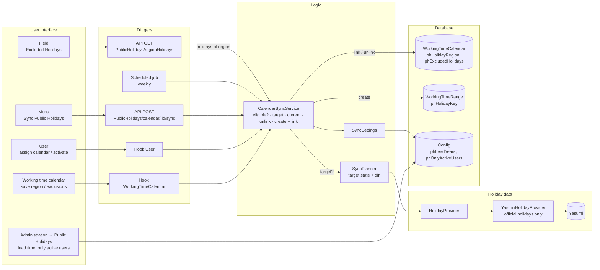

# Public Holidays for EspoCRM

**English** | [Deutsch](README.de.md)

Extension for EspoCRM 10.0.4 and later. It adds statutory public holidays automatically as **non-working exceptions** to working time calendars. Holidays are calculated with the [Yasumi](https://www.yasumi.dev) library for 156 countries and regions, including all German federal states, Austria and Switzerland.

## Features

- **Public holiday region per working time calendar:** a new "Public Holidays" panel on the calendar, e.g. *Germany – Baden-Württemberg*. Leave it empty to disable the feature for that calendar.
- **Excluded holidays:** single holidays of the region can be excluded per calendar.
- **Statutory holidays only:** only days of the Yasumi type "official" are created. Christmas Eve, New Year's Eve and regionally restricted days (e.g. Assumption Day in Bavaria) are not included.
- **One exception per holiday and region,** linked to all matching calendars.
- **Synchronization**
  - weekly via the scheduled job *Sync Public Holidays* (default: Mondays 03:15),
  - immediately when the region or the exclusions of a calendar change,
  - immediately when a user is assigned a calendar or is (re)activated,
  - manually via *Sync Public Holidays* in the calendar's menu.
- **Settings** under *Administration → Public Holidays*:
  - **Lead time (years):** 0 = until the end of the current year, **1 = until the end of the next year (default)**, up to 5.
  - **Only calendars of active users** (default: on): calendars without an active user are skipped.
- **Translations:** English and German. Other languages fall back to English.

## How it works



## Safety rules

- The extension identifies its own exceptions by the field `phHolidayKey` (e.g. `DE-BW:2027-05-27:corpusChristi`). **Other exceptions such as vacations, sick leave or manually created holidays are never touched.**
- **Nothing is deleted.** Links are removed only for the extension's own exceptions and only for holidays from today on, e.g. when the region or the exclusions change.
- **Past holidays are never changed.**
- If an automatically created exception is deleted, the next run creates it again. To remove a holiday permanently, use the **exclusions** of the calendar.
- Automatically created exceptions have a description in the system language, e.g. "Created automatically by the Public Holidays extension (Germany – Baden-Württemberg)."
- On uninstall, the created exceptions are kept. Only the scheduled job and the settings are removed.

## Migrating from manually maintained holidays

Manually created holidays have no `phHolidayKey` and are therefore not recognized. To avoid duplicates, delete manually created holiday exceptions **in the future** before the first synchronization.

## Installation

1. Download the package `public-holidays-x.y.z.zip` from the [Releases](../../releases) page.
2. In EspoCRM, upload and install it under *Administration → Extensions*.
3. Check the settings under *Administration → Public Holidays*.
4. Set the public holiday region in the working time calendars.

The EspoCRM cron must be active for the weekly synchronization.

## License

[MIT](LICENSE) © 2026 Oguz Binbir

The extension package includes [Yasumi](https://github.com/azuyalabs/yasumi) (MIT License). EspoCRM itself is licensed under AGPL-3.0.

---

## Development

Based on the official [ext-template](https://github.com/espocrm/ext-template).

### Structure

| Path | Content |
|---|---|
| `src/files/custom/Espo/Modules/PublicHolidays/Tools/YasumiHolidayProvider.php` | Holidays from Yasumi, type "official" only |
| `src/files/custom/Espo/Modules/PublicHolidays/Tools/SyncPlanner.php` | Pure planning logic without database (unit tested) |
| `src/files/custom/Espo/Modules/PublicHolidays/Tools/CalendarSyncService.php` | Synchronization with the database |
| `src/files/custom/Espo/Modules/PublicHolidays/Jobs/` | Scheduled job |
| `src/files/custom/Espo/Modules/PublicHolidays/Hooks/` | Sync on saving calendars and users |
| `src/files/custom/Espo/Modules/PublicHolidays/Api/` | `POST PublicHolidays/calendar/:id/sync`, `GET PublicHolidays/regionHolidays?region=` |
| `src/files/client/custom/modules/public-holidays/src/` | Frontend: sync action, exclusions field, settings page |
| `src/scripts/` | AfterInstall (scheduled job, defaults), AfterUninstall |
| `scripts/generate-regions.php` | Generates the region list and its translations from Yasumi |

### Setup

```bash
npm install
cp config-default.json config.json   # database and EspoCRM version (espocrm.branch)
npm run all                          # build and install EspoCRM in ./site, copy the extension
```

### Tests

**Unit tests** (no database; among others, the holidays of Baden-Württemberg 2026/2027/2030 against the law):

```bash
composer install
(cd src/files/custom/Espo/Modules/PublicHolidays && composer install --no-dev)
vendor/bin/phpunit
vendor/bin/phpstan analyse
```

**Integration tests** (real EspoCRM instance and database):

```bash
(cd site && grunt test)                 # once: create the test build
# create site/tests/integration/config.php with the credentials of an empty test database
scripts/integration-tests.sh
```

The integration tests cover, among others: creating and linking, repeated runs without changes, shared exceptions of several calendars, exclusions, region changes, unchanged past, untouched manual exceptions, active user filter, lead time, both hooks, the scheduled job, the API and EspoCRM's working time calculation (Corpus Christi is no longer a working day afterwards).

**GitHub Actions** (`.github/workflows/test.yml`) run on every push, on pull requests and **monthly**:
- unit tests and PHPStan with PHP 8.3 and 8.4,
- integration tests against **EspoCRM 10.0.4** (minimum version) and **stable** (latest version),
- package build. The installation package is available as an artifact.

The monthly run tests against the latest EspoCRM release even if the extension does not change, so a breaking EspoCRM update is noticed before you update your CRM. The Yasumi version is pinned in `composer.lock` and only changes when it is updated deliberately (see below); the tests then run because of the push.

### Updating Yasumi

```bash
cd src/files/custom/Espo/Modules/PublicHolidays
composer update azuyalabs/yasumi
cd -
php scripts/generate-regions.php   # regenerate the region list
vendor/bin/phpunit                 # checks among others that all regions are supported
```

### Release

1. Set the version and the changelog, commit and push to `main`:
   ```bash
   npm version patch --no-git-tag-version   # or minor / major; updates package.json
   # add a section "## [X.Y.Z] - date" to CHANGELOG.md
   ```
2. On GitHub: *Releases → Create a new release*, create the tag `vX.Y.Z` on `main`, enter a title and the release notes (e.g. the section from `CHANGELOG.md`), *Publish release*.

The workflow `.github/workflows/release.yml` then checks that the tag matches `package.json` and `CHANGELOG.md`, runs all tests, builds the package and attaches the ZIP file to the release. If anything fails, the release is turned back into a draft. See [CHANGELOG.md](CHANGELOG.md) for the history.

To build the package locally: `npm run extension` (output in `build/`).
